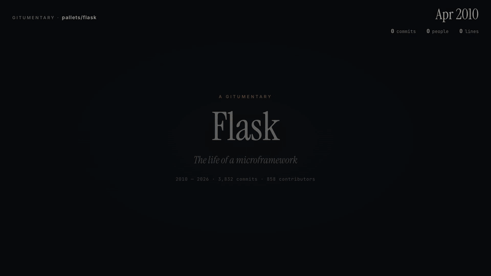

<div align="center">

# gitumentary

**Every repo has a story. This turns its git history into a two-minute documentary.**

Chapters. Narration. Plot twists. A cast of contributors. End credits.<br>
One command, one HTML file, zero dependencies.

[](https://github.com/annapurnageeks/gitumentary/actions/workflows/ci.yml)
[](https://github.com/annapurnageeks/gitumentary/releases)
[](#make-one-in-10-seconds)
[](gitumentary.py)
[](SKILL.md)
[](LICENSE)



**[▶ Watch the full Flask gitumentary](https://annapurnageeks.github.io/gitumentary/)**

</div>

### 🎞️ Gallery

| Film | Story |
|---|---|
| [**React**](https://annapurnageeks.github.io/gitumentary/react/) · 2013–2026 | 19,200 commits, 1,971 people, one million lines. Fiber, Hooks, a DevTools import reverted after four minutes, and a compiler codenamed Forget. |
| [**Flask**](https://annapurnageeks.github.io/gitumentary/) · 2010–2026 | “Initial checkin of stuff that exists so far.” Sixteen years of a microframework, and how it stopped growing but kept changing. |

🎬 **Download the films as MP4** from the [latest release](https://github.com/annapurnageeks/gitumentary/releases/latest). Made one of a project you love? [Share it](https://github.com/annapurnageeks/gitumentary/issues/new?template=share-a-film.yml), and the best ones go in the gallery.

---

## Make one in 10 seconds

```bash
git clone https://github.com/annapurnageeks/gitumentary
python3 gitumentary/gitumentary.py path/to/any/repo --open
```

That's it: Python 3.9+ and git, nothing to install. You get `documentary.html`, a self-contained film you can watch, screen-record, or host anywhere.

## Let an AI narrate it (much better)

The built-in narration sticks to the facts. An AI agent can dig through the history and tell the *story*: who showed up, what got rewritten, when it all went quiet.

gitumentary is an [agent skill](https://docs.claude.com/en/docs/claude-code/skills). Install it for Claude Code:

```bash
git clone https://github.com/annapurnageeks/gitumentary ~/.claude/skills/gitumentary
```

Then, in any repo, ask:

> make a gitumentary of this repo

The agent reads the facts (`--brief`), inspects the key commits, writes a script, and renders the film. It works with any agent that supports `SKILL.md` skills. Agents without skill support can follow [`SKILL.md`](SKILL.md) as plain instructions.

## What's in the film

| | |
|---|---|
| 🗺️ **A living map** | Every folder is a box sized by its lines of code. Watch the project grow, shrink and reorganize; boxes glow when they're being worked on. |
| 🎬 **Chapters** | The history is cut at natural turning points: release tags and long pauses. |
| 🎙️ **Narration** | Subtitles, one sentence at a time, written from real commit data. |
| ⚡ **Plot twists** | Cards for the biggest deletion, the longest silence, and milestones like *100 contributors* or *10,000 lines*. |
| 🌟 **End credits** | Everyone who contributed, rolling like a real movie. |

**Controls:** <kbd>Space</kbd> pause · <kbd>←</kbd> <kbd>→</kbd> chapters · <kbd>F</kbd> fullscreen · <kbd>H</kbd> hide controls (for screen recording) · add `#t=42` to the URL to share a moment.

## Options

```
python3 gitumentary.py [repo] [options]

  -o, --output FILE   where to write the film (default: documentary.html)
  --open              open it in your browser
  --brief             print the facts for each chapter, for writing narration
  --script FILE       use your own title, tagline and chapter narration (JSON)
  --title TEXT        the film's title (default: the repo's name)
  --everything        also count lockfiles and vendored or generated files
```

Write your own narration without an AI: run `--brief`, then fill in the JSON skeleton it prints. [`examples/flask.script.json`](examples/flask.script.json) is the script behind the demo.

## How it works

`gitumentary.py` is a single, commented, standard-library Python file:

1. **Read**: `git log --numstat` gives every commit and how many lines it changed in each file.
2. **Replay**: walking through the commits in order, it keeps a running line count per file, which tells it how big each folder was at every moment.
3. **Chapters**: it splits the history into 3–6 chapters, nudging each cut toward a release tag or a long pause, and collects facts about each one.
4. **Render**: everything goes into [`player.html`](player.html) as JSON. The player draws a squarified treemap on a canvas and runs the timeline.

It reads Flask's 3,800 commits in under a second, and React's 19,200 in about nine.

Run the tests with `python3 -m unittest discover tests`.

## Privacy

Everything runs locally. The film contains contributor **names** (no emails), commit messages, and folder names. Check those before you share a film of a private repo.

## Ideas and contributions welcome

See [CONTRIBUTING.md](CONTRIBUTING.md). Good first issues, if you want to help:

- [ ] **Export to MP4/GIF** straight from the player
- [ ] **Subtitles in sync with the timeline**: show each sentence when the map reaches the date it talks about
- [ ] **Voice-over** using the browser's speech synthesis
- [ ] **`--author "Name"`**: your personal story inside a project, for portfolios and performance reviews
- [ ] **Run on a GitHub URL** directly (clone into a temp folder)
- [ ] **Themes**: a light theme, a retro terminal theme, a "trailer" cut
- [ ] **Music** that follows the activity level

Made a film? [Share it here](https://github.com/annapurnageeks/gitumentary/issues/new?template=share-a-film.yml). The best ones go in the gallery.

## More from the same author

**[commit-wrapped](https://github.com/annapurnageeks/commit-wrapped)** turns your own year of commits into a Spotify-Wrapped-style story with a card you can share. [Watch React's 2026 →](https://annapurnageeks.github.io/commit-wrapped/)

## License

MIT
